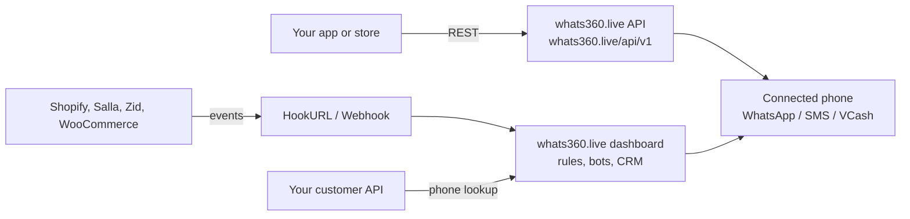

# Architecture of the whats360.live developer hub

Repositories: docs (`whats360-api-docs`), webhooks, Node.js and PHP clients, Postman, developer examples, integration examples, email API, VCash API. See [API_INDEX.md](API_INDEX.md).
